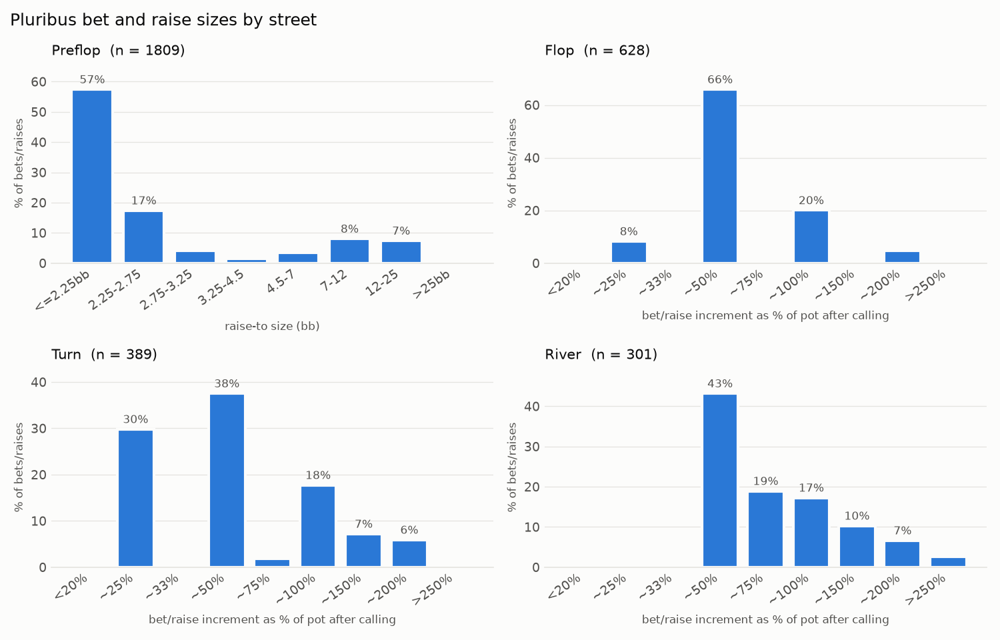

# M0: Pluribus descriptive stats

Generated by `analysis/m0_stats.py` from `data/pluribus_decisions.parquet` (built by `analysis/m0_parse.py` from `uoftcprg/phh-dataset`, `data/pluribus/`).

- Hands: **10,000**, all with stacks reset to 100 bb (10,000 chips), blinds 50/100.
- Pluribus decisions: **15,169** (preflop 10,299, flop 2,317, turn 1,513, river 1,040).
- Hole cards: all 6 players' hole cards are logged in **10,000 / 10,000** hands, including hands that ended before showdown.

## Raw win rate (no variance reduction)

**-7.09 bb/100** (standard error 8.81 bb/100, 95% CI -24.4 to +10.2). Total -708.6 bb over 10,000 hands.

The paper reports 48 mbb/game (= 4.8 bb/100) with AIVAT. The raw figure is much noisier: its standard error is several bb/100, so the two are not directly comparable.

| position | hands | net bb | bb/100 | s.e. |
|---|---:|---:|---:|---:|
| UTG | 1,663 | -300.6 | -18.1 | 19.0 |
| MP | 1,672 | +507.9 | +30.4 | 16.8 |
| CO | 1,682 | +80.0 | +4.8 | 20.4 |
| BTN | 1,692 | +453.4 | +26.8 | 23.3 |
| SB | 1,638 | -330.8 | -20.2 | 23.2 |
| BB | 1,653 | -1,118.5 | -67.7 | 25.6 |

## Preflop: VPIP, PFR, 3-bet by position

VPIP/PFR denominators exclude walks (BB hands folded to Pluribus, where it never acts).

| position | hands dealt | hands acted | VPIP | PFR | 3-bet opps | 3-bet |
|---|---:|---:|---:|---:|---:|---:|
| UTG | 1,663 | 1,663 | 18.5% | 18.3% | 2 | 0.0% |
| MP | 1,672 | 1,672 | 20.9% | 20.3% | 335 | 5.4% |
| CO | 1,682 | 1,682 | 23.6% | 21.8% | 585 | 6.3% |
| BTN | 1,692 | 1,692 | 27.8% | 22.3% | 871 | 6.8% |
| SB | 1,638 | 1,638 | 29.7% | 13.9% | 1,148 | 7.6% |
| BB | 1,653 | 1,488 | 42.3% | 10.0% | 1,164 | 8.3% |
| All | 10,000 | 9,835 | 26.9% | 18.0% | 4,105 | 7.3% |

## Flop: continuation bets and donk bets

| stat | opportunities | bets | rate |
|---|---:|---:|---:|
| C-bet (Pluribus was preflop aggressor, flop unbet when it acts) | 835 | 448 | 53.7% |
| Donk bet (bets into the preflop aggressor, who acts later) | 612 | 13 | 2.1% |

The donk row uses a loose v1 definition (flop only; Pluribus acts before the preflop aggressor, not necessarily first). See `m0_donk.md` for the strict definition (called the last bet, first to act, bets) by street, compared with the human players.

C-bet heads-up: 57.0% (n = 746); multiway: 25.8% (n = 89).

## Action mix by street

| street | n | fold | check | call | bet | raise |
|---|---:|---:|---:|---:|---:|---:|
| preflop | 10,299 | 71.6% | 0.6% | 10.3% | 0.0% | 17.6% |
| flop | 2,317 | 11.6% | 49.9% | 11.4% | 24.6% | 2.5% |
| turn | 1,513 | 13.2% | 48.9% | 12.2% | 24.1% | 1.6% |
| river | 1,040 | 15.8% | 44.2% | 11.1% | 25.2% | 3.8% |

## Bet and raise sizes by street

Preflop is binned by the raise-to amount in big blinds. Post-flop is binned by `bet_frac_pot` = (raise-to amount - current bet) / (pot after calling), so 100% is a pot-sized bet or raise. Counts:

| preflop raise-to | count |
|---|---:|
| <=2.25bb | 1039 |
| 2.25-2.75 | 315 |
| 2.75-3.25 | 75 |
| 3.25-4.5 | 26 |
| 4.5-7 | 63 |
| 7-12 | 146 |
| 12-25 | 134 |
| >25bb | 11 |

| pot fraction | flop | turn | river |
|---|---:|---:|---:|
| <20% | 0 | 0 | 2 |
| ~25% | 52 | 116 | 0 |
| ~33% | 0 | 0 | 1 |
| ~50% | 414 | 146 | 130 |
| ~75% | 4 | 7 | 57 |
| ~100% | 126 | 69 | 52 |
| ~150% | 1 | 28 | 31 |
| ~200% | 29 | 23 | 20 |
| >250% | 2 | 0 | 8 |

| street | median | mean | all-in share |
|---|---:|---:|---:|
| preflop (bb) | 2.25 | 4.24 | 0.0% |
| flop (pot) | 0.50 | 0.66 | 0.8% |
| turn (pot) | 0.50 | 0.68 | 1.5% |
| river (pot) | 0.75 | 0.90 | 6.3% |
